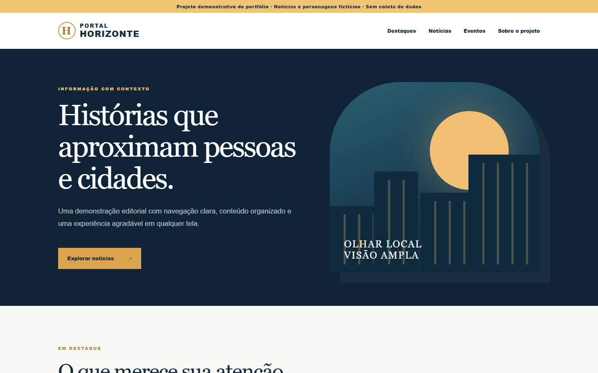

# Portal editorial - interface de portfólio

Versão pública e independente inspirada na experiência de desenvolver um portal editorial. **Não é uma cópia do portal em produção.** O conteúdo, a marca e os eventos são fictícios. Nenhuma imagem, anúncio, contato, configuração ou dado do projeto privado foi incluído.

## Recursos

- Página inicial editorial com destaques e cartões de notícias.
- Filtro por categoria e busca textual no navegador.
- Leitura de artigos em diálogo acessível.
- Layout responsivo, navegação móvel e estrutura HTML semântica.
- Nenhuma dependência, banco de dados, rastreador ou envio de informações.

## Executar

Abra `index.html` ou sirva a pasta com `python -m http.server 8000` e acesse `http://localhost:8000`.

## Contexto

O projeto privado que motivou esta versão usa Vite/React e Supabase. Esta versão de portfólio mostra apenas interações de interface com dados locais fictícios; não reproduz o painel administrativo nem as integrações de produção.
